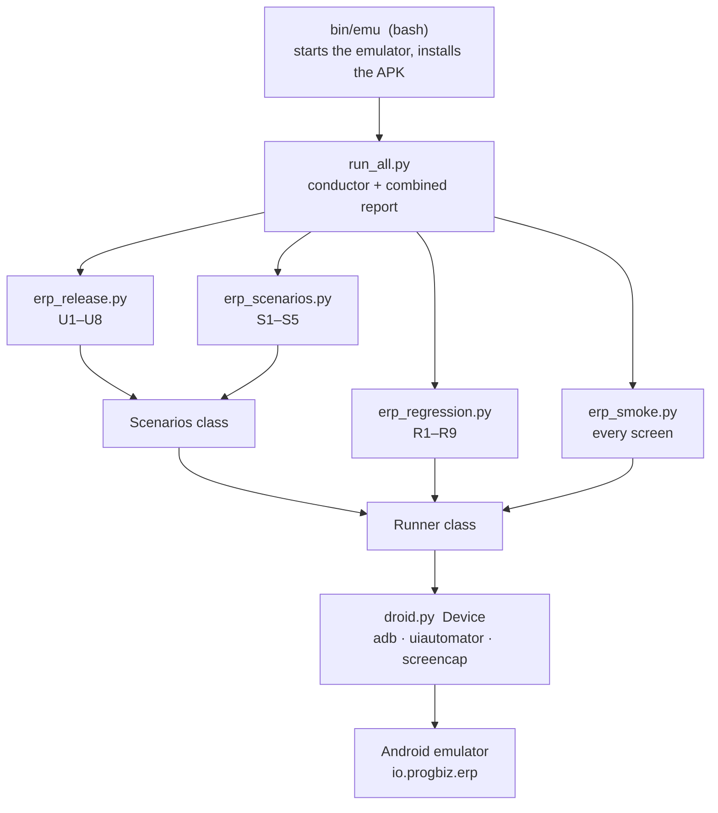

# Progbiz ERP mobile test automation — code details

Python 3 + adb scripts, about 3,000 lines, that drive the **real release APK** (`io.progbiz.erp`) on the Android emulator.
This is **not** an Android Studio app project: Android Studio only supplies the tools the code calls — the **emulator**,
**adb** and **uiautomator**. Nothing is added to the ERP app itself.

| | |
|---|---|
| Code | https://github.com/vismayatk/Progbiz-erp-testers/tree/add-mobile-emulator-tests/mobile (PR [#14](https://github.com/vismayatk/Progbiz-erp-testers/pull/14)) |
| Language | Python 3.9+ (standard library only; Pillow optional for smaller report images) and one bash script |
| Run | `emu all 13 <tenant>` — about 80 minutes, one combined HTML report with screenshots |
| Tested on | app v2.0.61, Android 13 emulator (Pixel 7, arm64), tenants `ncore_test`, `onetouch_test` |
| Other docs | `automation/SETUP.md` (install), `docs/TEST-FLOW.md` (every test case and its steps), `docs/ENVIRONMENTS.md` (URLs, tenants, login) |

## 1. Architecture



Class inheritance: `Release → Scenarios → Runner`, and `Regression → Runner`. Each suite is a program of its own with its own
`main()`; `run_all.py` starts them one by one as separate processes and reads their `results.json`.

## 2. How the code sees and touches the app (`droid.py`, 234 lines)

| What | How |
|---|---|
| Read the screen | `Device.nodes()` runs `uiautomator dump` and parses the XML into `Node` objects (text, content-desc, class, bounds, clickable, enabled). The ERP app is Flutter; most widgets have an accessibility label, which becomes `Node.label`. The dump is retried 3 times because it fails during animations |
| Find an element | `find()` — exact label, then starts-with, then contains (case-insensitive); or a compiled regex. Prefers clickable and smaller elements |
| Wait | `wait_for(label, timeout, gone=False)` polls every 0.6 s |
| Tap | `tap()` → `input tap x y` at the element's centre. **Before tapping**, the first line of the label is checked against `DENY` |
| Safety list | `DENY` (regex) blocks Logout, Check In/Out, Delete, Remove, Approve/Reject, Submit, Save, Send, Start/Stop/Pause, Yes/OK/Allow … A step must pass `allow_unsafe=True` on purpose |
| Other input | `scroll_down/up` (swipes), `back()` (keyevent 4), `hide_keyboard()`, `swipe()`, text via `adb shell input text` |
| Evidence | `screenshot()` (screencap), `crash_log()` (crash buffer, filtered to this app so a uiautomator crash is not blamed on it), `app_errors()` |
| App control | `launch()`, `force_stop()`, `app_version()`, `android_version()`, `foreground_package()` |

Paths can be overridden with environment variables: `ADB`, `ANDROID_HOME`, `QA_DIR`.

## 3. Shared navigation and report writer (`erp_smoke.py`, 554 lines)

`class Runner` — used by every suite:

| Method | Job |
|---|---|
| `go_home()` | back to the top of Home from anywhere (relaunch if needed, dismiss pop-ups, close the menu, tap the Home tab). Never presses Back on a root tab — that would exit the app |
| `dismiss_interrupts()` | handles the Check-In gate ("Continue Without Check-in"), the update prompt ("Maybe Later"), permission dialogs ("Don't allow"), Cancel/Close |
| `open_drawer()`, `tap_drawer_item()`, `run_step()` | open the side menu, expand a section such as "CRM, Collapsed", tap an item (scrolling the menu if needed) |
| `bottom_bar()`, `tap_tab()` | the 4 bottom tabs and the + button have no labels, so they are found by position |
| `discover()` | builds the test list from the live app: Home cards, View All, tabs, every menu section and item. New modules appear in the run by themselves |
| `wait_stable()` | a screen counts as loaded when there is no spinner, something is visible below the header, and two screen reads in a row match (digits are ignored so running timers do not count). The time taken is the load time |
| `check()` | per screen: open → load time → error text → empty state → crash/ANR → scroll + screenshot → first record → Home card count vs list |
| `open_first_record()`, `count_list()` | read-only drill-down and distinct-row counting |
| `shot()` | saves a PNG into the suite's `shots/` folder |

Module functions: `write_report()` (writes `results.json` and `report.html`), `embed_image()` (screenshot → small JPEG data URI so a
report is one self-contained file), `shot_html()`.

Result record used everywhere: `{group, name, kind, status PASS|WARN|FAIL, notes[], shots[], load_s}`.

## 4. The suites

**`erp_scenarios.py` — CRM flow and complaint (S1–S5).** `class Scenarios(Runner)`; creates data; refuses tenants outside `TEST_TENANTS`.

| Method | Job |
|---|---|
| `s1_new_enquiry` | fill the Add Lead form, Save, verify the Enquiry Overview and Item Details; measures customer-lookup and save time |
| `s2_followup` | ⋮ › Followup: status, lead quality, next date, description; Save; verify Follow-Up History |
| `s3_search` | Leads › search › Enter › expect "In Follow Up 1" and the row |
| `s4_quotation` | enquiry ⋮ › **Add Quotation** (pre-filled) → valid-up-to, item rate/quantity (item ⋮ › Edit), 10 % discount, description → Save → verify the overview and Item Details → **check the PDF** |
| `s5_complaint` | Complaints › New Complaint: type, subject, priority, QA customer, description, photo → Save → verify the Complaint Overview (number, status, details, attachment, timeline) and that the list's All count rose by 1 |
| `push_test_image()`, `pick_test_image()`, `tiny_png()` | build a small QA PNG, copy it to the emulator and pick it in the system photo picker (shared by S5 and release check U1) |
| `complaints_all_count()` | the count on the Complaints list's *All* tab |
| `check_quotation_pdf()` | Files tab › View opens the PDF; the file is read from the app cache with `adb root`, its text extracted (`pdf_text()`: macOS PDFKit via `osascript`, else `pdftotext`) and 14 values compared with what was entered |
| `choose_if_unset()` | the quotation form silently refuses to save without Lead Quality / Sales Executive — fills them when empty |
| `rupees_in_words()` | 1800 → "Rupee One Thousand Eight Hundred Only" (Indian grouping) for the PDF's total-in-words line |
| `cust_field(i)` | the phone/name/place boxes have no labels — found by position inside the "CUSTOMER DETAILS" card |
| `type_into()` | closes the keyboard (it shifts the form), taps, types, verifies the text arrived |
| `pick_date()` | handles both the old Material date dialog and the 2.0.59+ bottom-sheet picker, then the time picker |
| `open_enquiry()`, `save_and_wait()`, `banner_note()` | search by name, Save and wait for a screen, note an offline banner |
| per-tenant settings | `ITEM_SEARCH` ("Bio" / "Test"), `STATUS_PREF` (Call not answering / Contacted / Follow-up Pending), `TEST_TENANTS` |

**`erp_regression.py` — old bugs (279 lines).** `r1…r9`; each raises `Still` when the old bug is present (FAIL), returns normally when
fixed (PASS), and any other error becomes WARN ("could not check"). R8/R9 (logout) run only with `--logout`.

**`erp_release.py` — release-note checks (744 lines).** `class Release(Scenarios)`; `Missing` = not as released (FAIL),
`NotTestable` = cannot be tested on this tenant (WARN).

| Group | Methods |
|---|---|
| Nested menu | `open_path("Accounts", "Cheque Collection", "Cheques Collected")`, `toplevel()`, `section_items()`, `workflows()` (any section with a *Collections* item is a work flow module) |
| Forms | `fab()` (the + button), `top_right()` (⋮ menu), `cancel_form()`, `form_labels()`, `tap_value_of()` |
| Test file | `tiny_png()` builds a small PNG; `push_test_image()` copies it to the emulator; `pick_test_image()` selects it in the system picker |
| Checks | `u1_complaint_attachments` … `u8_phone_length`; U8 uses `set_phone()`, `fill_rest()`, `try_save()` |

**`erp_smoke.py` `main()`** — runs `discover()` then `check()` for each screen and writes the report.

## 5. The conductor (`run_all.py`, 324 lines)

1. `main()` — check the device, optional `adb install -r`, `ensure_logged_in()` (fills company code and username on the login screen
   and waits up to 10 minutes for the tester to type the password), `profile_company()` (reads the Profile tab; for `ncore_test` it must
   say "Ncore Builders" before any data is created).
2. `run_suite()` — runs each suite as a subprocess, copies its output to a log, finds its `Report:` path and `results.json`.
3. `write_index()` — combined `index.html`: summary table, every FAIL/WARN with screenshots, every check with thumbnails.
4. Extra modes without a device: `--combine YYYYMMDD` (latest result of every check from one day's runs → one report) and
   `--rebuild DIR…` (re-render old reports).

## 6. The emulator switcher (`bin/emu`, 453 lines of bash)

`emu start 13` (creates the AVD on first use), `emu stop`, `emu switch`, `emu install file.apk`, `emu shot`, `emu rec`, `emu crash`,
`emu test`, `emu scenarios`, `emu release`, `emu all <ver> <tenant> [apk|-] [suites]`. The test commands start the emulator first
if it is not running. It also manages iOS simulators (`emu ios …`), unused by these tests.

## 7. Safety rules in the code

- Passwords are never typed or stored.
- Data-creating suites run on `TEST_TENANTS` only; test data is named `QA_MOB_<timestamp>` and is never deleted by the scripts.
- `DENY` blocks destructive and attendance taps; permission prompts are declined; the update prompt is answered "Maybe Later".
- Settings, users and roles are never changed.

## 8. Limits and gotchas

- Only text the app exposes to accessibility can be read (e.g. the follow-up history status and the complaint chart text are not
  exposed) — such checks say so and rely on the screenshot.
- Tabs, the + button and form fields are found by position, so a large redesign (e.g. app 2.0.63) may need small updates.
- One script per emulator at a time: two `uiautomator` dumps at once crash each other.
- A busy Mac (load average above ~25) makes the emulator's watchdog kill it; after a crash it can reload an old snapshot with an
  older app version — check `versionName` before re-running.

## 9. Adding a check

One method plus one line in the suite's `plan` list. Example for "Profile shows the app version":

```python
def u9_profile_version(self, r):
    self.go_home()
    self.tap_tab(4)                                   # Profile tab
    r["shots"].append(self.shot("u9_profile"))
    if not self.d.exists(re.compile(r"Version \d+\.\d+")):
        raise Missing("Profile does not show the app version")
    r["notes"].append("Profile shows the app version")
```

then add `("U9", "Profile shows version", self.u9_profile_version)` to the list in `Release.run()`.
