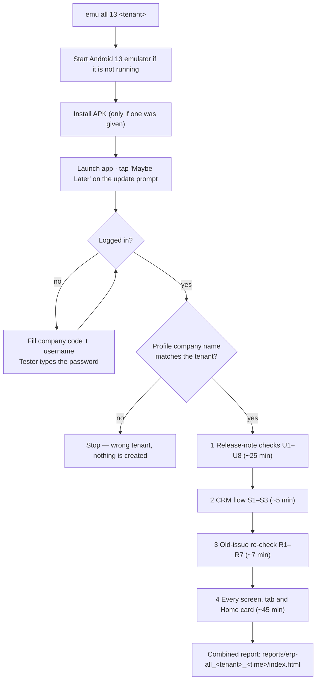
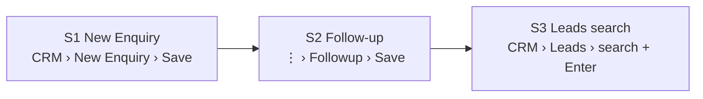

# Mobile test flow — steps and what each check covers

How `emu all 13 <tenant>` works from start to finish, and every test case it runs with its steps and expected result.
Environment, tenants and login steps: [ENVIRONMENTS.md](ENVIRONMENTS.md). Setup: [../automation/SETUP.md](../automation/SETUP.md).

## 1. The whole run

Total ≈ 80 minutes. Suites run one after another (two scripts on one emulator break each other).
Pick suites with `emu all 13 ncore_test - release,crm` (`-` = no APK to install).

How a check reads the app: the scripts dump the screen (`uiautomator dump`), find elements by their accessibility label, tap at the
element's centre, and wait until a screen stops changing. Anything the app does not expose to accessibility (for example the text
in the complaint chart) cannot be read — those checks say so and point to the screenshot.

Result meaning: **PASS** = as expected · **WARN** = slow, partly readable, or cannot be tested on this tenant ·
**FAIL** = not as expected. Every check stores at least one screenshot.

## 2. CRM flow (`erp_scenarios.py`, S1–S3) — creates test data

| ID | Steps | Expected result | Also measured |
|---|---|---|---|
| **S1** New Enquiry → overview | CRM › New Enquiry. Type phone (fake number). Wait until Customer Name becomes editable again (the app looks the customer up). Type name `QA_MOB_<ts>` and place `QA_Place`. Item: tap the row above Quantity, search ("Bio" on onetouch_test, "Test" on ncore_test), pick the first result. Type a description. Next follow-up: switch the row on, pick a date +2 days and the time. Assign To › You. Save | Enquiry Overview shows the ENQ number, name, place, status **New**, assignee = signed-in user, follow-up date and the phone. Item Details tab shows the item and the description | customer-lookup time (WARN over 5 s), save time (WARN over 10 s), offline banner |
| **S2** Follow-up → history | Open that enquiry (⋮ › Followup). Pick the first available status of *Call not answering / Contacted / Follow-up Pending*. Lead Quality › Warm (only if the tenant has it). Next Followup Date +4 days. Type description `QA_followup_<ts>`. Save | Back on the Enquiry Overview; **Follow-Up History** shows the description. (Status and next date are on screen but not exposed to accessibility — the check records WARN and the screenshot proves them) | time to load the status list (WARN over 5 s), save time |
| **S3** Leads search | Back. CRM › Leads › search icon › type the QA name › **Enter** | The **In Follow Up** tab shows count 1 and the row `ENQ-n` with the name | time to find it |

## 3. Release-note checks (`erp_release.py`, U1–U8)

| ID | Release note | Steps | Expected result (PASS) |
|---|---|---|---|
| **U1** | Complaints: attach images, files, voice notes | Complaints › New Complaint. Look for Attachments. A small QA test PNG is copied to the emulator; tap **Photos**, pick it. Tap **Remove**. Cancel the form | Attachments `0/10` with Photos, Camera, File, Voice note. After picking: `1/10` and a thumbnail. After Remove: `0/10`. (Camera, File picking and voice recording are not exercised — they need the camera/microphone) |
| **U2** | Cheque Management module | Menu › Accounts › Cheque Collection › Cheques Collected, Ready for Deposit, Deposited Cheques; Cheque Issue › Issued Cheques, Uncleared Cheques, Cheque Master. On three screens tap **+** and close the form | All six screens open; add forms: *New Collection*, *Issue Cheques*, *Add Cheque Book*. WARN "not testable" if the user has no Accounts menu (permission) |
| **U3** | Collection: next follow-up, opening collection, print | Find the first Collections list with a record. Open it › ⋮ menu. List › **+** › Add Collection › pick the project. Open the project record › **Collections** tab › **Add ▾** | ⋮ has **Print** (`--print` opens the receipt PDF). Add Collection has a **FOLLOW-UP** section (Next Follow-up, Remarks, "save without a receipt"). Add ▾ offers **Opening Collection** (Amount Collected, As On Date, Ref No, Description) |
| **U4** | Profile: Availability | Profile tab (bottom right) | An **Available** toggle is listed. The test never switches it |
| **U5** | Work Flow custom fields | Each work flow's **New …** form: list the fields after *Lead Source* up to the next section; open the Type list | Custom fields present (e.g. Plot Area, Built-up Area, No. of Floors, Permit No., Retention %). WARN if none are configured |
| **U6** | Work Flow Solar: Consumer field | Create-form of a work flow whose type name contains "Solar" | A **Consumer** field exists. WARN "not testable" when the tenant has no Solar type |
| **U7** | Collection cards show "Added by" | Read the first card on Collections | The card text includes "Added by <name>" |
| **U8** | Phone numbers accept 5–20 digits only | CRM › New Enquiry. Fill the form with a unique number of 4, 21, 6 and 20 digits and Save each | 4 and 21 digits are **not saved**; 6 and 20 digits **are saved**. A lead is saved (as `QA_MOB_…`) only when the app accepts the number; numbers matching an existing customer are skipped. The report notes the app's message and how long it took (a rejected save with no message after 40 s is recorded as "nothing") |

## 4. Old-issue re-check (`erp_regression.py`, R1–R9)

FAIL means the old bug **is still there**; PASS means it is fixed.

| ID | Old issue | Steps | Fixed when |
|---|---|---|---|
| R1 | Back button does not close the side menu | Open the menu, press Back | the menu closes |
| R2 | Leads search only runs on Enter | Leads › search icon › type a nonsense word, do **not** press Enter, wait 8 s | no lead rows are listed |
| R3 | Past follow-up dates can be picked | New Enquiry › Next follow-up › date picker | yesterday is disabled |
| R4 | Complaint chart shows raw keys | Dashboard › Complaint › read "Open By Status & Priority" | no `newComplaint` / `onHold` style names |
| R5 | "New Enquiry" menu opens a form titled "Add Lead" | open the form, read the title | the title matches the menu |
| R6 | False "no internet" banner | Home, Leads and the CRM dashboard, 25 s each | no banner appears |
| R7 | WhatsApp Chat gives no guidance | Menu › WhatsApp Chat | text explains what to do, not only "Please add whatsapp account" |
| R8 | Logout does nothing | Profile › Logout › confirm (`--logout` only — ends the session) | login screen within 30 s |
| R9 | Login fields have no accessibility labels | login screen (after R8) | every field has a label |

## 5. Every screen (`erp_smoke.py`) — read-only

The script builds its own list from the live app, so it follows menu changes (for example the new Accounts and Travel Bookings sections).

1. Home: the stat cards (Completed / Delayed / Pending), **View All**.
2. The four bottom tabs: Calendar, + (opened and closed), History, Profile.
3. Every side-menu section and each item under it. "New …" forms are opened and closed without typing.

For each screen the script records:

| Check | WARN / FAIL when |
|---|---|
| Opens | the screen does not change after the tap (FAIL) |
| Load time | still loading after 20 s, or more than 5 s to settle (WARN) |
| Error text | "Something went wrong", "Exception", "null", HTTP 4xx/5xx |
| Empty state | "No data / No records / Nothing here" is noted |
| Crash / ANR | any crash of the app in the log, or the app leaves the foreground (FAIL) |
| First record | the first list item is opened (read-only) and screenshotted |
| Home card counts | the number on the card differs from the rows in its list |
| Offline banner | "No internet / Connection lost" appears |

## 6. Safety rules in the code

- The scripts never type a password and never store one.
- `droid.DENY` blocks taps on Logout, Check In/Out, Delete, Remove, Approve/Reject, Submit, Send, Start/Stop/Pause, Yes/OK/Allow.
  Only the data-creating steps pass `allow_unsafe=True`, and only on their own `QA_MOB_` record.
- Data-creating suites run on test tenants only (see ENVIRONMENTS.md).
- Permission prompts are answered **Don't allow**; the update prompt **Maybe Later**.
- Settings, users, roles and tenant configuration are never changed by the scripts.

## 7. Reading the reports

`reports/erp-all_<tenant>_<time>/index.html` (single file, screenshots embedded):

1. a table with pass / warn / fail per suite and links to each suite's report and log;
2. every FAIL and WARN with its screenshots and notes;
3. every check of every suite as a card with thumbnails.

Re-run only some checks: `python3 erp_release.py --serial emulator-5554 --tenant ncore_test --only U3,U8`, then build one report from
the day's latest results with `python3 run_all.py --tenant ncore_test --combine YYYYMMDD`.

## 8. Latest result (v2.0.61 · ncore_test · 28 Oct 2026)

| Suite | Pass | Warn | Fail |
|---|---|---|---|
| Release-note checks | 6 | 1 (U6: no Solar type) | 1 (U8: phone rule) |
| CRM flow | 1 | 2 | 0 |
| Old-issue re-check | 1 | 0 | 6 |
| Every screen (43) | 40 | 3 | 0 |

Open issues at that time: phone length is 7–15 (not 5–20) and Save shows no message for 4 or 21 digits; Back does not close the side
menu; Leads search needs Enter; past follow-up dates can be picked; the complaint chart shows `newComplaint` / `onHold`;
the form title is "Add Lead"; WhatsApp Chat has no guidance. "Added by" on Collection cards was fixed server-side on 28 Oct.
